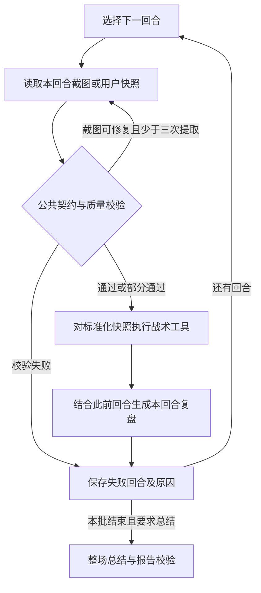

# 整场开局截图连续复盘

适用于一场比赛的每回合开局截图。支持 13 回合以上、加时、逐回合上传、批量 API 和中断恢复；每场当前上限为 100 回合，每回合最多 10 张图片。Web 默认一张图对应一个回合，API 可把同一回合的记分板和小地图放进同一项 `images`。

## 编排与数据边界



- 图节点：`select_round`、`extract`、`validate`、`analyze`、`review`、`save_round`、`summarize`。
- `match_id` 对应 LangGraph 的 `thread_id`。每个节点的状态写入 SQLite；模型异常会保留待执行节点，恢复调用使用 `ainvoke(None, config)`。
- 图状态只有 JSON 值。模型对象、密钥和 API 配置只存在于当前调用对象，不进入检查点。图片单独保存为内容哈希文件，图中只保存引用，避免每个检查点复制 base64。
- 提取时只读取当前回合图片。历史回合用于后续比较，不能拿历史金币、装备、位置填补本回合未知值。
- 战术工具由宿主按依赖调用，直接读取 `validate_round_data` 返回的标准化快照，模型不会重新填写工具的快照参数。
- 每回合的提取最多三次；最终报告复用现有 CoachResponse 校验和最多两次格式修复。错误快照不送入战术工具，失败回合仍保留记录，后续回合可继续处理。
- 连续性比较保留回合缺口、队伍视角、攻防变化和余额时点。只有相邻开局比分变化明确时确认上一回合结果；余额变化仅在完整、非估算且同攻防和同一时点时比较，不能等同于收入或花费。
- 所有单回合报告的证据路径加上宿主回合 ID 前缀，整场报告可以明确引用不同回合。总结使用时间线与逐回合报告，不重发历史截图。

## API

### 分析或补传

`POST /api/matches/analyze`

```json
{
  "match_id": "team-game-001",
  "text": "关注团队购买是否协调，以及经济变化",
  "observations": ["整场以我方队伍为 ally"],
  "rounds": [
    {"round_index": 1, "images": [{"name": "r01.png", "data": "BASE64"}]},
    {"round_index": 2, "images": [{"name": "r02.png", "data": "BASE64"}]}
  ],
  "summarize": true,
  "replace_existing": false
}
```

`match_id` 可省略，服务器会生成编号并返回。编号仅允许 1–64 位字母、数字、下划线和短横线。`rounds` 按 `round_index` 排序，同批不能有重复编号。单张图片最大 20 MB，请求体仍限制 64 MB；推荐像 Web 界面一样分批上传，前面的请求设置 `summarize: false`，最后发送 `rounds: []`、`summarize: true` 汇总。

每项也可以传 `snapshot`（完整 RoundSnapshot 对象）和可选的 `position_snapshot`，替代截图。宿主管理 match_id/round_id，保留用户提供的游戏数据；快照的 `round_index` 必须与外层一致。单回合的备注使用该项的 `text`，避免把某回合事实误当整场事实。

配置真实模型沿用页面/服务端 `.env`；也可以传 `config: {format, base_url, model, api_key}` 仅用于本次请求。恢复时需要重新提供临时配置，或使用服务器已保存的配置。离线模式使用 `force_demo: true` 并提供结构化快照；同一比赛不允许混合离线和真实模式。

相同回合与相同输入重复提交会被去重。更正已有回合需要 `replace_existing: true`；插入缺失回合或更正输入会使该回合及之后的报告重新分析。已存在中断批次时先恢复，不能插入新批次。同一进程内同一比赛仅允许一个分析请求，冲突返回 HTTP 409；不同比赛可并行处理。

`POST /api/analyze` 的 `task_type: "match_review"` 加 `images` 或 `rounds` 也会进入该工作流，突破单次 AgentLoop 的十图限制；旧的购买/站位接口保持兼容。

### 查看和恢复

- `GET /api/matches/{match_id}`：查看已保存回合、当前步骤、时间线、逐回合报告、整场报告和是否可恢复。不存在返回 404。
- `POST /api/matches/{match_id}/resume`：不带新回合，恢复最后的待执行节点。若原批次设置了 `summarize: false`，恢复后仍只保存回合；再调用分析接口提交空回合数组即可总结。

返回的关键字段包括 `completed_rounds`、`failed_rounds`、`current_round`、`next_round`、`can_resume`、`timeline`、`rounds`、`report`、`markdown`、`trace`。未要求总结时 `report` 为 null；失败回合计入已保存回合，并在 `failed_rounds` 单独列出。

## CLI 快照/图片清单

`--rounds` 接受 RoundSnapshot 数组，也接受以下回合输入数组。图片路径相对于 JSON 清单所在目录解析。

```json
[
  {"round_index": 1, "images": ["screenshots/r01.png"], "text": "这局想保经济"},
  {"round_index": 2, "images": ["screenshots/r02.png", "screenshots/r02-minimap.png"]}
]
```

使用 `--image-dir` 时按文件名自然排序，一张图对应一回合，起点由 `--start-round` 指定。需要同一回合多图时使用清单。`--state-db` 可指定 SQLite 文件；默认与 Web 相同，均为仓库根目录下的 `.state/matches.sqlite`。

## 验证与当前范围

测试覆盖 13 张开局图片的顺序上下文、SQLite 跨服务实例读取、模型失败恢复、校验重试上限、失败回合隔离、重复提交、补传、更正后重新计算、同比赛并发冲突、HTTP 接口及 CLI。

逐回合流程会用回合备注或购买主题调用 `get_coaching_advice`，将指南条目连同计算结果交给报告生成步骤。整场总结另查跨回合评估规则。位置计算沿用 Sunset 数据契约。报告会注明缺失回合、未核验的规则和观察范围。
